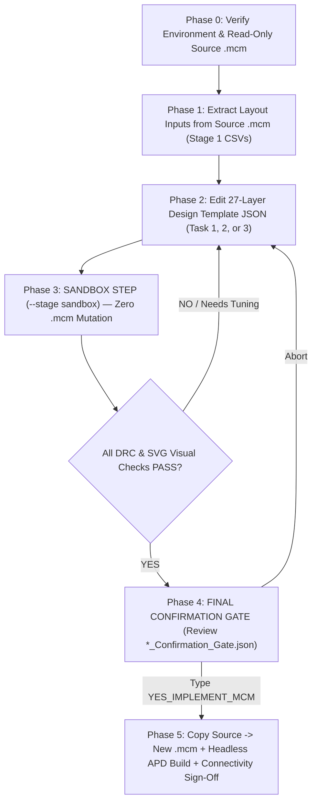

# Step-by-Step Tutorial: Building a New `.mcm` from an Existing `.mcm` with Sandbox & Final Confirmation Gate

> [!IMPORTANT]
> **Safety-by-Design Architecture:**
> 1. Your original `.mcm` database (for example [`PDN_test.mcm`](file:///<agent_workspace>/agent04_pdn_architect/MCM_test/PDN_test.mcm) or `HH_Nguyen_*_TO_v8.mcm`) is treated as **100% Read-Only**.
> 2. `<pcbenv_skill_dir>/` is **never modified**.
> 3. Every PDN build MUST pass through the **Sandbox Simulation + SVG Visual Gate** (`--stage sandbox`) and an explicit **Final Confirmation Gate** (`--stage implement-mcm` requiring `YES_IMPLEMENT_MCM`) before a copied output `.mcm` is touched by Cadence APD (`apd.exe -nographic`).

---

## End-to-End 5-Phase Workflow ("Build `.mcm` from `.mcm`")



---

## Phase 0 — Prerequisites & Read-Only Safety Rules

1. **Confirm workspace directory:**
   ```powershell
   cd <agent_workspace>
   ```
2. **Confirm Cadence APD 25.1 availability** (needed only for Stage 1 extraction from a fresh `.mcm` and Phase 5 `.mcm` build; **Phases 2–3 Sandbox run purely in standard Python**):
   ```powershell
   python -c "from agent09_via_routing.cad_cli.cadence_runner import CadenceBatchRunner; import json; print(json.dumps(CadenceBatchRunner().check_environment(), indent=2))"
   ```
3. **Rule of thumb for `source_mcm_readonly` vs `output_mcm_path`:**
   The validator [`validate_27layer_template_config`](file:///<agent_workspace>/agent04_pdn_architect/templates/pdn_27layer_template_runner.py#L84-L163) automatically **blocks execution** if `output_mcm_path` has the same filename/path as `source_mcm_readonly`.

---

## Phase 1 — Extract Design Inputs from Any Starting `.mcm` (Stage 1)

If you are starting from a **new `.mcm`** (or a new tape-out revision of an `.mcm`), first extract its physical bumps, BGA balls, `4FCO` `eDTC` pins, placed `BASE` LSCs, stackup layers, and padstack spans into `agent04_pdn_architect/stage1_inputs/`:

```powershell
python -c "from agent04_pdn_architect.cad_cli.stage1_input_builder import run_stage1_full_input_preparation; print(run_stage1_full_input_preparation(mcm_path=r'agent04_pdn_architect/MCM_test/PDN_test.mcm', run_headless_apd_extract=True))"
```

*(If you are already working on the current Hutton Hill `TO_v8` / `PDN_test.mcm` dataset, these CSVs are already prepared under [`agent04_pdn_architect/stage1_inputs/`](file:///<agent_workspace>/agent04_pdn_architect/stage1_inputs): `bga_map.csv`, `bump_map.csv`, `u9_full_pins.csv`, `u13_u41_u5_full_pins.csv`, `edtc_pin_map.csv`, `edtc_symbols.csv`, `lsc_placed_map.csv`, `die_bridge_refdes_summary.csv`, `stackup_53layers.csv`.)*

---

## Phase 2 — Customize Your Full 27-Layer Design Template (Pick Task 1, 2, or 3)

Open the editable JSON template for the PDN task you want to build and adjust any parameter:

| Task | Domain / Rails | Editable 27-Layer Template JSON |
| :---: | :--- | :--- |
| **Task 1** | `LDB` (`U7..U5` `VDDUC0..3`) & `LDC` (`U2..U1` `VDDCH0..3`) | [`task1_vdduc_vddch_27layer_template.json`](file:///<agent_workspace>/agent04_pdn_architect/templates/task1_vdduc_vddch_27layer_template.json) |
| **Task 2** | `LDA` Co-Planar (`U9, U12, U88, U10` `VDDC0..3` + `VDD_0P8_SRAM_CC0..3`) | [`task2_vddc_sram_27layer_template.json`](file:///<agent_workspace>/agent04_pdn_architect/templates/task2_vddc_sram_27layer_template.json) |
| **Task 3** | `HBM4E` 4-Rail + `EMIB` (`U13..U24` + `U41..U52`: `VDDQ, VDDC, VDDQL, VPP`) | [`task3_hbm_4rail_27layer_template.json`](file:///<agent_workspace>/agent04_pdn_architect/templates/task3_hbm_4rail_27layer_template.json) |

### Key Knobs Designers Commonly Modify
1. **`design_io`**: Set `source_mcm_readonly` (your input `.mcm`) and `output_mcm_path` (your brand-new output `.mcm` filename).
2. **`zone1_surface_escape` (`L01 SURFACE`)**:
   - Task 1: `surface_vip_ratio` (`"FULL"`, `"3:1"`, `"4:2"`, `"5:2"`), `strap_direction` (`"VERTICAL"`, `"HORIZONTAL"`, `"BOTH"`).
   - Task 2: `surface_routing_mode` (`"PARTIAL_3_TO_1_VERTICAL_C_S_JOG"`, `"PARTIAL_3_TO_1_HORIZONTAL_COLLAR"`, `"FULL_VIP"`), `vertical_jog_trace_width_um` (`15.0`).
   - Task 3: `west_non_emib_gang_stripe_height_um` (`90.0`), `west_strap_width_um` (`35.0`).
3. **`zone3_edtc_and_core_pth` (`4FCO..4BCO`)**:
   - Real compact per-device `eDTC` KOZs (`N24792-018` `96p`, `N24792-017` `48p`, `N24792-016` `24p`), `edtc_static_guard_band_width_um` (`150.0`), Core PTH density/pattern (`7.0/mm²`, `"STAGGERED"`).
4. **`zone4_middle_bu_continuity_and_stack_limits`**:
   - Enforces unbroken `9F->5F` & `9B->5B` `VSS`/`VDD` continuity and strict **zero per-conductor via pad overlap** (`max_stacked_bu_vias = 7`, `<= 5` on PTH).
5. **`zone5_base_bga_curved_recess_and_lsc` (`L27 BASE`)**:
   - BGA via cluster (`4-via`, `5-via`, `6-via` hex, or `8-via` octagon), `lsc_sro_to_sro_min_um` (`175` or `250 µm`), and **Curved BGA-Following `POLY_CAVITY`** parameters (`mill_tool_radius_um: 508.0`, `bga_sro_to_cavity_min_um: 254.0`, `ext_cu_to_cavity_koz_um: 178.0`, `lsc_sro_to_cavity_min_um: 225.0`).
6. **`stackup_all_27_layers` (`L01..L27`)**:
   - Customize net assignments, `DYNAMIC` vs `DYNAMIC_PLUS_STATIC_GUARD`, and split gaps (`>= 50 µm` BU, `>= 67.5 µm` Core/PP/GCP).

---

## Phase 3 — Mandatory SANDBOX Step (Zero `.mcm` Mutation + Visual SVG Gate)

**NEVER skip directly to `.mcm` generation.** First run the compiler in **`--stage sandbox`** (the default safe mode). This does **not** open or modify any `.mcm` file:

```powershell
# Run Sandbox for ONE task (example: Task 2 LDA)
python -m agent04_pdn_architect.templates.pdn_27layer_template_runner --config agent04_pdn_architect/templates/task2_vddc_sram_27layer_template.json --stage sandbox

# OR run Sandbox across ALL 3 TASKS at once
python -m agent04_pdn_architect.templates.pdn_27layer_template_runner --all-3-tasks --stage sandbox
```

### What the Sandbox Step Produces & Checks Automatically
1. **Hard DRC Guardrails:**
   - Rejects unsafe template edits (`split_gap_um < 50/67.5 µm`, `max_stacked_bu_vias > 7`, `BASE`-only LSC violations, `R_mill < 500 µm`, or `source_mcm == output_mcm`).
   - Runs [`audit_via_continuity_and_zero_overlap`](file:///<agent_workspace>/agent04_pdn_architect/cad_cli/multi_rail_polygon_engine.py#L1407-L1471) across all 27 conductor layers (`non_concentric_pad_overlap_count == 0`, `9F->5F` and `9B->5B` non-zero `VSS` & `VDD` stitch continuity).
   - Verifies curved `POLY_CAVITY` clearances (`BGA SRO->Cav >= 254 µm`, `Ext Cu->Cav >= 178 µm`, `LSC SRO->Cav >= 225 µm`, `0` EMIB shadow violations) and `180°` cap-to-cap LSC alternation.
2. **Visual Gate SVGs to Open & Inspect in Your Browser:**
   - **27-Layer Full PDN Blueprint:** `agent04_pdn_architect/reports/template_builds/<task>/*_27Layer_Blueprint.svg` *(shows `SURFACE/10F`, `9F->5F`, `4FCO/6F`, `2FCI Core`, `9B->5B`, `12B/BASE`, and the 24-span vertical continuity bar chart)*.
   - **27-Layer Stackup Inventory Table:** `*_27Layer_Stackup_Summary.svg`.
   - **L01 SURFACE `3:1` + `15 µm` Vertical Jog View (Task 2):** `*_SURFACE_3to1_VerticalJog.svg`.
   - **L27 BASE Curved Recess & `180°` LSC View:** `*_BASE_Curved_Recess_LSC.svg` *(zoom in to confirm smooth BGA-hugging cavities and `0°/180°`/`90°/270°` cap-to-cap polarity)*.
3. **Final Confirmation Gate Card:** `agent04_pdn_architect/reports/template_builds/<task>/<TASK_ID>_Confirmation_Gate.json`.

> [!WARNING]
> If `drc_all_pass` is `false` or anything in the SVGs looks undesirable, adjust your template JSON and re-run `--stage sandbox` until satisfied. The tool will **refuse** to build an `.mcm` while `drc_all_pass == false`.

---

## Phase 4 — Final Confirmation Gate (Before Any `.mcm` Is Touched)

Once you have inspected the SVGs and [`*_Confirmation_Gate.json`](file:///<agent_workspace>/agent04_pdn_architect/reports/template_builds/task2_vddc_sram/TASK2_VDDC_SRAM_Confirmation_Gate.json), launch the `.mcm` implementation command **without** a bypass token so you get the interactive Final Confirmation prompt:

```powershell
# Example for Task 2 (replace --config with task1_... or task3_... as needed)
python -m agent04_pdn_architect.templates.pdn_27layer_template_runner --config agent04_pdn_architect/templates/task2_vddc_sram_27layer_template.json --stage implement-mcm
```

The runner prints the complete **Final Confirmation Card**:
- `source_mcm_readonly` (guarantees your input `.mcm` stays untouched)
- `output_mcm_target` (exact path of the new `.mcm` that will be created)
- Exact object counts (`copper_planes_and_islands`, `plane_voids_edtc_and_emib`, `vias_all_26_spans`, `cline_segments`, `base_0201_lscs`, `curved_recess_pockets`)
- All inspected SVG file paths

Then it pauses at:
```text
Have you inspected the Sandbox SVGs? Type 'YES_IMPLEMENT_MCM' to build the new .mcm:
```
- Type **`YES_IMPLEMENT_MCM`** and press Enter to approve `.mcm` creation.
- Press Enter (or type anything else) to **abort cleanly with zero `.mcm` changes**.

*(For scripted/unattended CI runs only after prior sign-off, you can pass `--non-interactive --confirm-token YES_IMPLEMENT_MCM`.)*

---

## Phase 5 — Headless `.mcm` Build, Post-Route Connectivity & Final GUI Check

As soon as you type `YES_IMPLEMENT_MCM`, [`implement_sandbox_to_mcm_with_confirmation`](file:///<agent_workspace>/agent04_pdn_architect/templates/pdn_27layer_template_runner.py#L1002-L1095) automatically executes the full APD flow:

1. **Safe `.mcm` Copy:** Copies `source_mcm_readonly` $\rightarrow$ `output_mcm_target` and clears any stale `.lck` lock file.
2. **Headless Cadence APD 25.1 Execution:** Launches `apd.exe -product Allegro_Adv_Packaging_Plus -nographic` and executes [`apd_unified_27layer_template_importer.il`](file:///<agent_workspace>/agent04_pdn_architect/templates/apd_unified_27layer_template_importer.il):
   - Creates `SUBSTRATE GEOMETRY/recess_cavity_pdn`, `SUBSTRATE GEOMETRY/LSC_CAVITY`, and `ROUTE KEEPOUT/BASE` curved `POLY_CAVITY` outlines.
   - Places `CONDUCTOR/BASE` LSCs via `mir = nil` + `pin->startEnd` check and assigns `Pin "1" = <VDD>` / `Pin "2" = VSS`.
   - Builds **Dynamic** copper planes (`axlShapeChangeDynamicType`) with `eDTC`/`EMIB`/split voids + **Static** `150 µm` Guard Bands.
   - Instantiates all `VIA` and `CLINE` records, smooths dynamic shapes (`axlShapeDynamicUpdate(nil t)`), re-enables online DRC, and saves `output_mcm_target`.
3. **Automated Post-Route Database Connectivity Audit:** Inspect [`<TASK_ID>_MCM_Implementation_Audit.json`](file:///<agent_workspace>/agent04_pdn_architect/reports/template_builds) and confirm:
   - `ERRORS = 0`
   - `DB_DYNAMIC_CONDUCTOR_SHAPES > 0` and `DB_RECESS_CAVITY_PDN_SHAPES > 0`
   - `DB_NET_<RAIL>_OPEN_PIN_BRANCHES = 0` and `DB_NET_<RAIL>_FLOATING_BRANCHES = 0`
4. **Optional 3D Independent Connectivity & Degassing Sign-Off (`allegro-mcm-drc`):**
   Open the newly generated `.mcm` in Cadence APD GUI to visually review `SUBSTRATE GEOMETRY/recess_cavity_pdn`, `12F..12B` dynamic shapes, and run **Tools $\rightarrow$ Update DRC**, or invoke `allegro-mcm-drc` to verify zero opens/shorts from Die Bump $\rightarrow$ Core PTH $\rightarrow$ `BASE` BGA/LSC.
